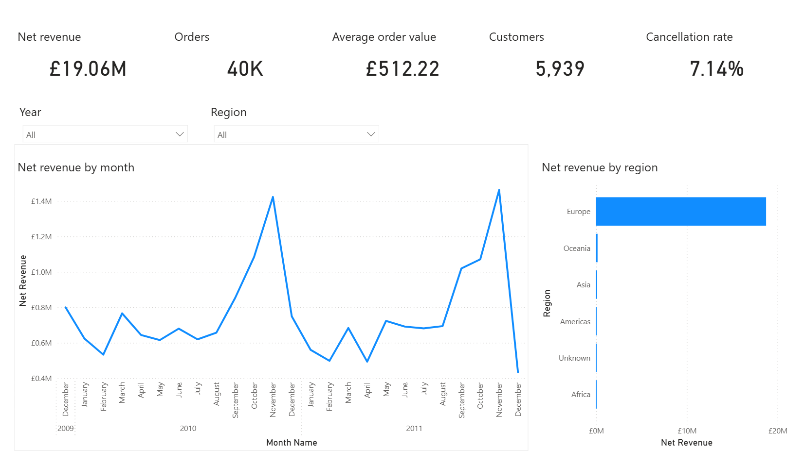
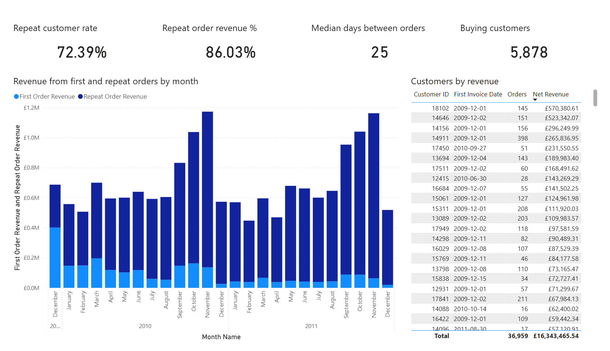
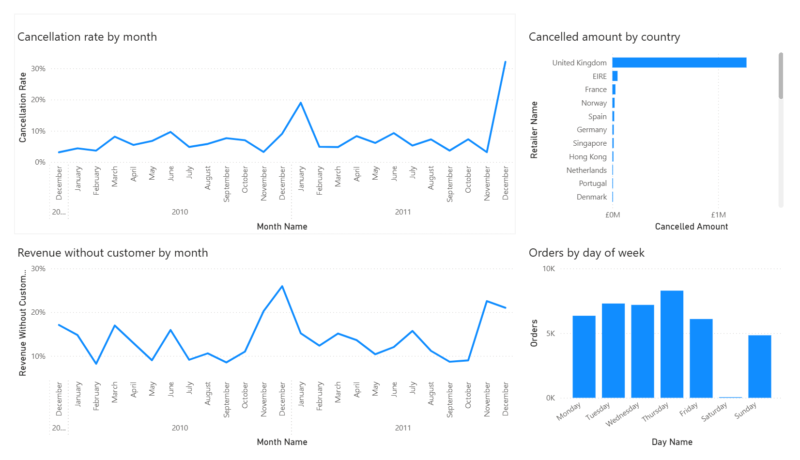
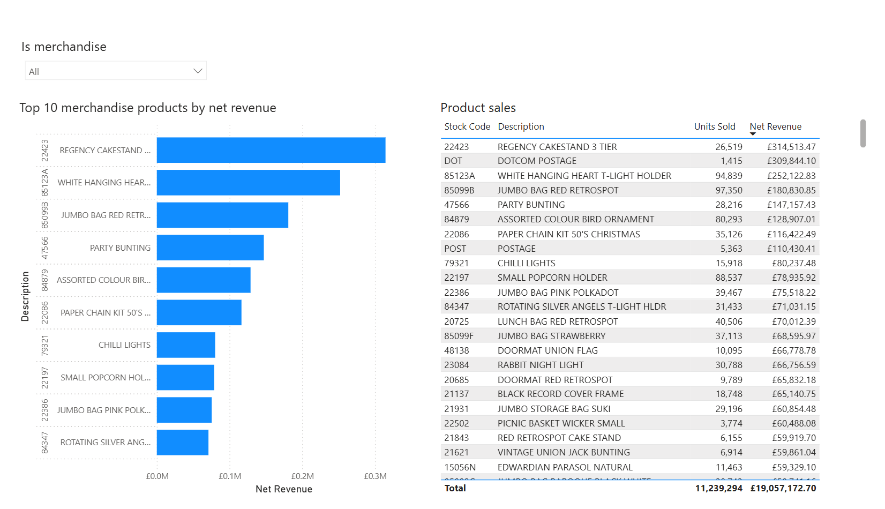
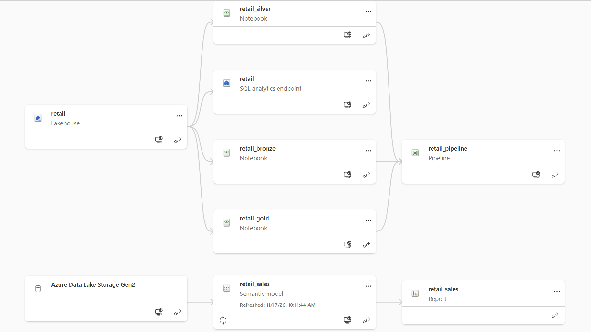

<div align="center">

# Retail sales pipeline

**When does a UK online gift shop sell, who keeps coming back, and where does the money leak?**

I took two years of invoice lines from a UK online gift retailer, the UCI Online Retail II dataset,
cleaned them in SQL into a star schema, and built a Power BI report on top of it. The report and the
pipeline both run in Microsoft Fabric.

[](tests/)
[](pyproject.toml)
[](docs/data-sources.md)

**Data and warehouse**

[](fabric/)
[](pipeline/lake.py)
[](pipeline/transform.py)
[](sql/)

**BI and reporting**

[](powerbi/)
[](powerbi/retail-sales.SemanticModel/definition/expressions.tmdl)
[](powerbi/retail-sales.SemanticModel/definition/tables/Sales.tmdl)
[](docs/data-model.md)

**Engineering and quality**

[](pipeline/)
[](tests/)
[](uv.lock)

</div>
## What the data shows



- The business is seasonal. November is the largest month in both years, with 1,461,756 pounds in 2011 and 1,422,655 pounds in 2010, and revenue climbs from September onward, which fits a gift shop in the run-up to Christmas.
- It did not grow. January to November brought 8,498,611 pounds in 2010 and 8,576,185 pounds in 2011, which is less than one percent more.
- The line falls at the end because the data stops on 9 December 2011, so the last month is not a whole month.



- Repeat customers carry the revenue. Of the customers who bought in the two years, 72.4% came back for a second order, and repeat orders make up 86.0% of the revenue from known customers. The median gap between two orders of the same customer is 25 days.
- A few customers matter a lot. The top 1% of customers, 59 of 5,939, bring 31.2% of the revenue from known customers.
- The United Kingdom is 84.9% of net revenue.



- Cancellations take 7.14% of gross sales over the two years.
- The shop barely trades on Saturdays. There are 30 orders on a Saturday in two years and 4,835 on a Sunday, so Saturday looks like a closed day rather than a slow one.



`tests/test_findings.py` asserts every number in this section against the gold tables.

## How the data was prepared

The workbook goes into bronze as text, is cleaned into silver with SQL, and becomes a star schema in gold. Every layer is a set of Delta tables, and every transformation is a SQL file that DuckDB runs.

| | |
|---|---|
| Invoice lines read | 1,067,371 |
| Lines kept | 1,038,804 |
| Lines rejected, each with a reason | 28,567 |
| Distinct invoices | 48,354 |
| Net amount | 19,057,172.698 pounds |

These numbers are asserted in `tests/test_silver.py` and `tests/test_gold.py`, and `tests/test_independent_totals.py` recomputes them from the workbook in plain Python, without the pipeline code or SQL, and compares.

## Run it

It needs Python 3.11 or later and [uv](https://docs.astral.sh/uv/). On the first run it downloads the workbook (45 MB), the country list and two DuckDB extensions.

```
uv sync
uv run python -m pipeline.bronze
uv run python -m pipeline.transform silver
uv run python -m pipeline.checks silver
uv run python -m pipeline.transform gold
uv run python -m pipeline.checks gold
uv run pytest
```

The tables are written under `data/lake`, which is not committed. On a fresh clone the tests that need the real data are skipped until the pipeline has run.

## Run it on Fabric

`fabric/deploy.py` uploads the code to a lakehouse and imports three Python notebooks and a data pipeline that runs them in order. It also publishes the Power BI model and report, with the model pointed at the gold tables of the lakehouse instead of a local folder. It needs the [Fabric CLI](https://microsoft.github.io/fabric-cli/), logged in, and a lakehouse that was created with schemas enabled.

```
uv run python fabric/deploy.py "My workspace.Personal" retail
fab job run "My workspace.Personal/retail_pipeline.DataPipeline"
```



The box called Azure Data Lake Storage Gen2 is the gold folder of the same lakehouse. Fabric shows it as a separate source because the model reads it through its OneLake address.

Each notebook runs the same commands as above against the lakehouse, so the checks run there as well, and a failing check fails the pipeline. I ran it on a Fabric trial capacity, where one run takes about three minutes. I compared the row counts of the twelve tables and the net amount with what my machine gives, and they were the same. That comparison was a query in a notebook of my own, and it is not in this repository.

The published model needs one sign-in on its data source credentials in the Power BI service before its first refresh. After that I refreshed it and asked it for the same totals with a DAX query, and it gave the same kept lines, invoices and net amount as the table above.

## Power BI

`powerbi/retail-sales.pbip` opens in Power BI Desktop. Each of its six tables is a Power Query that reads one gold Delta table with `DeltaLake.Table` from the gold folder under the `LakeRoot` parameter, so the parameter has to point at your own `data/lake` before the first refresh. The report has four pages: Overview, Products, Customers and Operations.

I checked it in Power BI Desktop 2.159. After a refresh the Products table totals 19,057,172.70 pounds and the Customers card shows 5,939, which are the numbers that the tests assert. The Customers page is built on `fact_orders`, which numbers the orders of every customer in time order, and it counts 4,255 customers who ordered more than once.

## Layout

```
pipeline/    bronze ingest, the SQL runner, the check runner
sql/         silver, gold and checks, one statement per file
reference/   retailer country names mapped to ISO codes, written by hand
tests/       small literal fixtures with literal expected values, plus tests on the real data
powerbi/     semantic model and report over the gold tables
fabric/      notebooks, the pipeline definition and the deploy script
docs/        data sources, transformation rules, data model and lineage
```

## What was hard

The two sheets of the workbook overlap. Both contain 1 to 9 December 2010, line for line, which is 22,523 lines, and nothing in the workbook says so. It only shows when the date ranges of the two sheets are put side by side, and counting those nine days twice would inflate December 2010.

Bronze keeps every column as text. Read as text, the dates arrive as Excel serial numbers and a price of 2.55 arrives as 2.5499999999999998, so the typing rules in silver had to be exact, and each one has a test with a literal expected value.

Delta has two timestamp types, and the one without a time zone is not readable by the Fabric SQL analytics endpoint, Direct Lake, Dataflows Gen2 or pipelines. My first version wrote that type without my noticing, because DuckDB picks it for a plain timestamp. I store the invoice time with a UTC label now, and a test asserts that no table uses the newer Delta protocol.

Fabric was harder than I expected, for two reasons. The notebook kernel comes with DuckDB 1.2 and delta-rs 0.18, which are older than the versions that I locked, and it keeps the old DuckDB loaded even after an upgrade, so each notebook runs the pipeline in a separate process that uv builds from `uv.lock`. The second reason is that delta-rs cannot write through the lakehouse mount, because the mount does not allow a file to be renamed. On Fabric the tables are therefore written through the OneLake URL and read through the mount.

I did not use Spark, because one million lines fit on one machine and DuckDB reads and writes the same Delta tables. In total the pipeline is about 200 lines of Python and 21 SQL files.

## What is not done

- On Fabric it runs in my personal workspace on a trial capacity, because my tenant does not let me create a workspace. The pipeline has no schedule, and I started every run by hand.
- On Fabric the report is in my personal workspace and I have not shared it with anyone. The pipeline does not refresh the model, so I refresh it by hand after a run.
- `fabric/deploy.py` only adds and replaces files, so a file that I delete from the repository stays in the lakehouse until I remove it there.
- A first order is only the first one inside the two years of data. The workbook starts on 1 December 2009, so in the first months the report counts old customers as new ones.
- Lines that repeat another line of the same invoice exactly are kept, because the workbook has no line number and I cannot tell a double scan from a double export.
- The invoice time has the right clock time and a wrong zone label, which matters only if it is converted to another zone.
- Korea is mapped to South Korea, which is an assumption. The country list itself says it is not authoritative.

## Data and license

I put the code under the MIT license. None of the data is in this repository. Online Retail II is CC BY 4.0 (Chen, D., 2012, https://doi.org/10.24432/C5CG6D) and the country list is CC BY-SA 4.0. `docs/data-sources.md` has the details.
