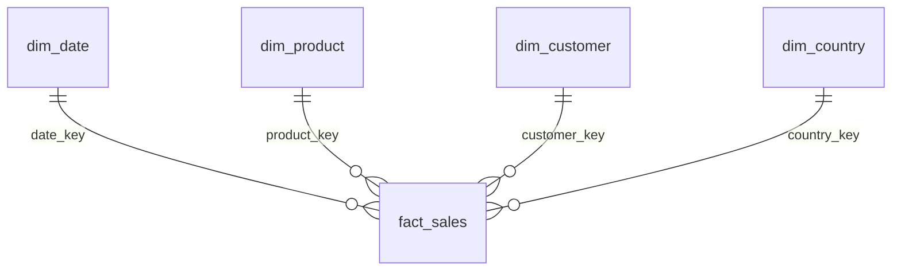

# Data model

Gold is a star schema with one fact table and four dimensions. The grain of `fact_sales` is one invoice line that survived silver.

## Tables

| Table | Rows | One row is | Key |
|---|---|---|---|
| fact_sales | 1,038,804 | an invoice line | source_sheet, source_row |
| dim_date | 739 | a calendar day, 1 December 2009 to 9 December 2011 | date_key (yyyymmdd) |
| dim_product | 4,758 | a stock code | product_key |
| dim_customer | 5,940 | a customer, plus the unknown customer at key 0 | customer_key |
| dim_country | 43 | a country name as the retailer writes it | country_key |

`fact_sales` carries invoice_no, the four keys, is_cancellation, quantity, unit_price, line_amount and invoice_ts. The invoice number stays in the fact table and has no dimension of its own, because nothing else is known about an invoice.

## Relationships

Every relationship is many fact rows to one dimension row, and none of them is optional. A line with no customer points to the unknown customer and not to null, so a report that groups by customer does not lose 229,327 lines without anyone noticing.

| From | To | On |
|---|---|---|
| fact_sales.date_key | dim_date.date_key | the day of invoice_ts |
| fact_sales.product_key | dim_product.product_key | stock_code |
| fact_sales.customer_key | dim_customer.customer_key | customer_id, or key 0 when it is null |
| fact_sales.country_key | dim_country.country_key | the country name of the line |

The country is on the line and not on the customer, because the same customer appears under more than one country in the workbook.

## Lineage

| Gold table | Built from | Which comes from |
|---|---|---|
| fact_sales | silver.invoice_lines and the four dimensions | bronze.online_retail_lines, the two sheets of the workbook |
| dim_date | the first and last day in silver.invoice_lines | the same |
| dim_product | stock_code and description in silver.invoice_lines | the same |
| dim_customer | customer_id and invoice_ts in silver.invoice_lines | the same |
| dim_country | silver.countries | bronze.country_names (`reference/country_names.csv`) joined to bronze.country_codes (the ISO list) |

A line can be followed in both directions. `source_sheet` and `source_row` are the sheet and the row position of the line in the workbook, and they are carried unchanged from bronze through silver to `fact_sales`. A line that is not in the fact table is in `silver.rejected_lines` with the reason.

## Numbers

The totals of `fact_sales` are 48,354 distinct invoices and a net amount of 19,057,172.698 pounds. `tests/test_gold.py` asserts both, and `tests/test_independent_totals.py` recomputes them from the workbook in plain Python, without the pipeline code or SQL, and compares.
